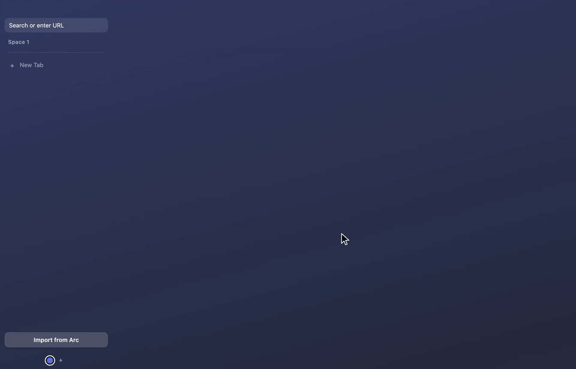

# camber

An open-source browser with Arc's sidebar, spaces, pinned tabs and command bar.

Made by [Yuvraj Angad Singh](https://github.com/yuvrajangadsingh)



## Why

Arc is being sunset on Dec 22 2026. It was closed source, so nobody can fork it.
camber keeps the parts people liked: a vertical sidebar, spaces with their own
logins, pinned tabs and folders, and a keyboard command bar. No AI features.

Why Electron: it ships the same Chromium as Chrome (156 today), and Electron
already runs on macOS, Linux and Windows, so camber does too from day one with
no Chromium fork to port. A new Chromium is an Electron version bump
(Dependabot opens the PR), not a Chromium build.

## Download

Builds go on the releases page. None of them are signed yet.

| OS | Build | Tested |
| --- | --- | --- |
| macOS, Apple Silicon | DMG (`arm64`) | yes, launched from the DMG |
| macOS, Intel | DMG (`x64`) | not yet |
| Linux, x64 | AppImage, deb | not yet |
| Linux, arm64 | AppImage, deb | deb installed and run on Ubuntu 24.04 (Xvfb) |
| Windows, x64 | zip (installer coming) | not yet |
| Windows, arm64 | not built yet | |

- macOS: the first open is refused because the app isn't notarized. Right click
  camber.app, Open, then Open again, or run
  `xattr -dr com.apple.quarantine /Applications/camber.app`.
- Linux: `sudo apt install ./camber-*.deb`, or `chmod +x camber-*.AppImage` and run it.
- Windows: SmartScreen warns about an unknown publisher; More info, Run anyway.

## Run from source

```sh
npm install && npm start
```

Builds land in `dist/`: `npm run dist` (macOS), `npm run dist:linux` and
`npm run dist:win` (on Linux or in the electron-builder Docker image), or
`npm run dist:all` for everything (needs Docker).

`npm run demo` starts with a throwaway profile, and its Import from Arc reads
`demo/arc-demo.json` (three made-up spaces of public sites) instead of your Arc
data. Use it for screenshots and recordings.

## Use

Cmd on macOS, Ctrl on Linux and Windows.

| Keys | Does |
| --- | --- |
| Cmd+T | command bar: URL, DuckDuckGo search, or jump to an open tab |
| Cmd+L | edit the current tab's URL |
| Cmd+W | close tab (pinned tabs just unload) |
| Cmd+D | pin or unpin |
| Cmd+R, Cmd+[, Cmd+] | reload, back, forward |
| Cmd+S | toggle sidebar |
| Cmd+Ctrl+Left/Right (Ctrl+Alt on Linux/Windows) | previous/next space |

Each space has a profile, and each profile is its own session, so logins stay
apart. Spaces can share a profile, like in Arc.

## Moving from Arc

File > Import from Arc reads Arc's sidebar file where Arc keeps it on macOS and
on Windows. On Linux, or to bring a file from another machine, copy
`StorableSidebar.json` over and use File > Import Arc File….

What comes over:

- spaces with their names and colors
- Arc's profiles: spaces that shared a profile in Arc share logins in camber
- favorites (the icon grid at the top), per profile
- pinned tabs with the names you gave them in Arc
- folders, nested as deep as you had them
- unpinned (today) tabs

Importing again replaces the spaces from the earlier import instead of adding
copies. Not imported: history, passwords, bookmarks, extensions, Boosts and
Easels. Split views and tab groups become plain tabs. You sign in to sites again.

State lives in `state.json` in the app's user data folder.

Extensions: install from the Chrome Web Store (File > Chrome Web Store), and their
buttons show up in the sidebar. Bitwarden installs and its popup opens; autofill
with a logged-in vault is untested, and 1Password does not work yet.

## Remote debugging

Off by default. To turn it on for one run:

```sh
npx electron . --remote-debugging-port=9333
```

Anything on your machine can then drive the browser, so leave it off normally.

## Status

v0. Works for daily poking around, not yet for daily driving: builds are
unsigned and there is no auto-update.

## License

Copyright (C) 2026 Yuvraj Angad Singh. Licensed under GPL-3.0-only, see LICENSE.
