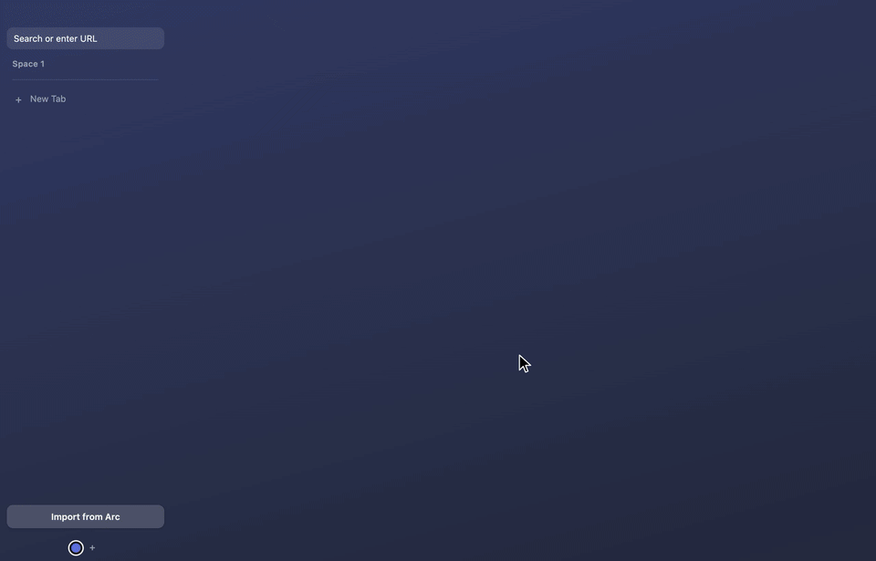

# camber

A free, open-source Arc alternative for macOS, Windows and Linux, with Arc's sidebar, spaces,
pinned tabs and command bar. It imports your spaces, pinned tabs and folders from Arc, which stops
working on December 22, 2026.

By default, tabs you haven't looked at for an hour give their memory back and stay in the
sidebar; the tab on screen and tabs playing sound stay loaded. With 23 tabs open, camber went from
4.9 GB to 0.85 GB after the unload (summed RSS of every camber process, from source in demo mode on
an M5 MacBook Air).

Download: [latest release](https://github.com/yuvrajangadsingh/camber/releases/latest) ·
Website: [yuvrajangadsingh.com/camber](https://www.yuvrajangadsingh.com/camber)

Made by [Yuvraj Angad Singh](https://github.com/yuvrajangadsingh)

[](https://www.opensourcealternatives.to)



## What it looks like

A space: pinned tabs, a Docs folder open, the page on the right.


Split view: two tabs side by side, the active one ringed.


Peek: Cmd+Shift+click a pinned tab to look at it without leaving the page.


Little window: a link from another app opens here, Open in camber moves it into a space.


Command bar: Cmd+T, type a few letters, jump to an open tab or search.


## Why

Arc is being sunset on Dec 22 2026. It was closed source, so nobody can fork it.
camber keeps the parts people liked: a vertical sidebar, spaces with their own
logins, pinned tabs and folders, and a keyboard command bar. No AI features.

Why Electron: it ships the same Chromium as Chrome (156 today), and Electron
already runs on macOS, Linux and Windows, so camber does too from day one with
no Chromium fork to port. A new Chromium is an Electron version bump
(Dependabot opens the PR), not a Chromium build.

## Download

Get the installer for your system from the
[releases page](https://github.com/yuvrajangadsingh/camber/releases) and check it
against `SHA256SUMS.txt`. What changed in each release is in [CHANGELOG.md](CHANGELOG.md).

On macOS, Homebrew installs it too and clears the quarantine flag, so the app opens
without the warning below:

```sh
brew install yuvrajangadsingh/tap/camber
```

| OS | File | Tested |
| --- | --- | --- |
| macOS, Apple Silicon | `camber-<version>-arm64.dmg` | launched in CI (GitHub's Apple Silicon runner) and from the DMG on a Mac |
| macOS, Intel | `camber-<version>-x64.dmg` | launched in CI (GitHub's Intel macOS runner) |
| Windows, x64 | `camber-<version>-x64.exe` | installed silently and launched in CI |
| Linux, x64 | `.deb`, `.AppImage` | both launched in CI (Ubuntu, virtual display) |
| Linux, arm64 | `.deb`, `.AppImage` | deb launched in CI; AppImage not run yet |
| Windows, arm64 | not built yet | |

"Launched" means the app started, imported a sample Arc file and showed it in the
sidebar. Nothing is signed yet:

- macOS: the app is not notarized, so the first open is refused. Right click
  camber.app, Open, then Open again. On macOS 15 and later: try to open it once,
  then System Settings > Privacy & Security > Open Anyway. Or run
  `xattr -dr com.apple.quarantine /Applications/camber.app`.
- Windows: SmartScreen warns about an unknown publisher; More info, Run anyway.
- Linux: `sudo apt install ./camber-*.deb`, or `chmod +x camber-*.AppImage` and
  run it. If it complains about FUSE, add `--appimage-extract-and-run`.

## Run from source

```sh
npm install && npm start
```

Builds land in `dist/`: `npm run dist` (macOS), `npm run dist:linux` and
`npm run dist:win` (on Linux or in the electron-builder Docker image), or
`npm run dist:all` for everything (needs Docker).

`npm run demo` starts with a throwaway profile, and its Import from Arc reads
`demo/arc-demo.json` (three made-up spaces of public sites) instead of your Arc
data. Use it for screenshots and recordings.

## Use

Cmd on macOS, Ctrl on Linux and Windows.

| Keys | Does |
| --- | --- |
| Cmd+T | command bar: URL, DuckDuckGo search, or jump to an open tab |
| Cmd+L | edit the current tab's URL |
| Cmd+W | close tab (pinned tabs just unload) |
| Cmd+D | pin or unpin |
| Cmd+R, Cmd+[, Cmd+] | reload, back, forward |
| Cmd+S | toggle sidebar |
| Cmd+Shift+N | little window |
| Cmd+O | move the little window's page (or a peek) into the current space |
| Cmd+Shift+\ | close split view |
| Cmd+Ctrl+Left/Right (Ctrl+Alt on Linux/Windows) | previous/next space |

Drag tabs to reorder them; dropping a tab among the pinned ones pins it, and
dropping a pinned tab under New Tab unpins it. Double-click a space's name to
rename it. Closing a tab takes you back to the tab you were on before it.
Unpinned tabs you haven't opened for 12 hours are closed (Tab > Archive After:
12h, 24h or Off).

Tab > Split with… (or "split" in the command bar) puts another tab of the space
next to the current one; click a side to make it active. Shift+click a favorite,
or Cmd+Shift+click a pinned tab, to peek at it over the page: Esc or a click
outside closes it, Open as tab keeps it. A playing video pops out into
picture-in-picture when you leave its tab and comes back when you return (Tab >
Pop out video when leaving a tab).

File > Make camber the Default Browser sends links from other apps to camber.
On Linux, if that doesn't stick, run
`xdg-settings set default-web-browser camber.desktop`. A link from outside opens
in a little window; Open in camber (Cmd+O) moves it into the current space.

Each space has a profile, and each profile is its own session, so logins stay
apart. Spaces can share a profile, like in Arc.

## Moving from Arc

File > Import from Arc reads Arc's sidebar file where Arc keeps it on macOS and
on Windows. On Linux, or to bring a file from another machine, copy
`StorableSidebar.json` over and use File > Import Arc File…. On Windows and Linux
the menus (File, Tab, Help) open from the ≡ button at the top left of the sidebar.

What comes over:

- spaces with their names and colors
- Arc's profiles: spaces that shared a profile in Arc share logins in camber
- favorites (the icon grid at the top), per profile
- pinned tabs with the names you gave them in Arc
- folders, nested as deep as you had them
- unpinned (today) tabs

Importing again replaces the spaces from the earlier import instead of adding
copies. Not imported: history, passwords, bookmarks, extensions, Boosts and
Easels. Split views and tab groups become plain tabs. You sign in to sites again.

Air Traffic Control: on a site, Tab > Always Open Links to This Site in This
Space, and links to it (and its subdomains) from other apps open in that space.
Tab > Forget Routing Rule for This Site undoes it.

State lives in `state.json` in the app's user data folder.

Extensions: install from the Chrome Web Store (File > Chrome Web Store), and their
buttons show up in the sidebar.

Tabs you haven't looked at for an hour give their memory back and stay in the
sidebar; clicking one loads it again (Tab > Unload After: 30m, 1h, 3h, Off). The tab
on screen, both halves of a split, tabs playing sound and tabs with a
picture-in-picture video stay loaded (a muted video popped out of an embedded player
is not noticed). Form input on an unloaded page is lost, like a reload.

Memory: 23 loaded tabs (electronjs.org docs, GitHub, Wikipedia and MDN across three
spaces) on an M5 Air took 4.9 GB; after the idle unload 0.85 GB. That is the summed
RSS of every camber process, from source in demo mode, 60 s after the last tab
opened and 30 s after the unload. Electron is not lighter than Arc's native shell;
this is what the sidebar costs with its tabs asleep.

## Known gaps

- 1Password doesn't work yet. Bitwarden installs and opens; autofill with a
  logged-in vault is untested.
- No code signing, no Windows arm64 build. Updates install themselves only on Windows
  and the AppImage (from the next release on); macOS and the .deb get a note in the sidebar.
- No Widevine: Netflix, Prime Video, Disney+ and Spotify web do not play (stock
  Electron ships no DRM module).
- No USB, HID, serial, Bluetooth or screen sharing: sites asking for them are refused.
- No sync, Boosts or Live Folders.

## Remote debugging

Off by default. To turn it on for one run:

```sh
npx electron . --remote-debugging-port=9333
```

Anything on your machine can then drive the browser, so leave it off normally.

## Status

v0. Works for daily poking around, not yet for daily driving: builds are
unsigned. camber asks GitHub for the latest release 10 seconds after startup and
every 6 hours. On Windows and the AppImage it downloads a newer release from this
repo's GitHub releases in the background and offers a Restart button in the
sidebar; it never restarts by itself. On macOS (the app isn't signed, so it can't
update itself) and the .deb it shows a note that links to the release. The full
list of what camber sends is on its
[privacy page](https://www.yuvrajangadsingh.com/camber/privacy).

camber is in beta, so you will hit bugs. Feedback in the sidebar (or Help > Report
a Bug… on macOS) opens GitHub's issue form in your browser with camber's version and
your OS filled in. That address goes to GitHub when the page opens; nothing is
posted until you submit. Ideas are welcome there too.

## License

Copyright (C) 2026 Yuvraj Angad Singh. Licensed under GPL-3.0-only, see LICENSE.
